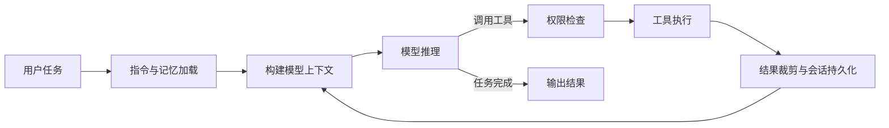

# Coding Agent

基于 ReAct 工具调用循环的终端编程助手。模型通过读取文件、搜索代码、编辑内容和执行命令完成编程任务，支持多模型接入、MCP 工具扩展、跨会话记忆、上下文压缩和多 Agent 协作。

## 技术栈

Python 3.11+ · Textual · Anthropic SDK · OpenAI SDK · MCP · Pydantic · WebSocket。

## 执行流程



## 核心能力

| 模块 | 实现 |
| --- | --- |
| Agent 循环 | 流式处理模型输出、工具调用和执行结果，支持终端交互与非交互任务执行 |
| 多模型接入 | 配置 Anthropic、OpenAI 与 OpenAI 兼容接口，按供应商协议构造请求 |
| MCP 延迟加载 | 通过 ToolSearch 按关键词或工具名发现并加载延迟工具，减少一次性注入的工具定义 |
| 会话持久化 | 使用 JSONL 保存消息、工具调用与压缩边界，支持恢复会话 |
| 跨会话记忆 | 用户级与项目级记忆、自动提取与归并、记忆召回和分级指令加载 |
| 上下文压缩 | 先裁剪与外置工具结果，再对历史前缀生成摘要，保留近期原文；包含触发阈值与熔断保护 |
| 权限控制 | 危险操作检查、文件路径范围、规则匹配、权限模式与人工确认，支持会话级授权 |
| 平台沙箱 | 提供 Linux bubblewrap 和 macOS Seatbelt 后端，按运行平台及配置启用 |
| 多 Agent 协作 | 子任务与团队管理、成员通信、共享任务状态以及 Git worktree 隔离 |
| 扩展机制 | 技能加载、Hooks 与 WebSocket 远程交互入口 |

## 本地启动

```bash
uv sync
cp .coding_agent/config.yaml.example .coding_agent/config.yaml
```

在配置文件中设置供应商协议、API 地址和模型名称，密钥通过环境变量引用。示例使用 `ANTHROPIC_API_KEY`：

```bash
export ANTHROPIC_API_KEY="<your-api-key>"
uv run coding_agent
```

上述命令使用 Bash；PowerShell 中可用 `$env:ANTHROPIC_API_KEY="<your-api-key>"` 设置当前会话变量。

非交互执行：

```bash
uv run coding_agent -p "阅读当前项目，说明主入口与核心模块"
uv run coding_agent -p "为指定函数补充测试" --output-format stream-json
```

## 指令与配置

| 路径 | 用途 |
| --- | --- |
| `.coding_agent/config.yaml` | 模型、权限与 MCP 配置 |
| `~/.coding_agent/CODING_AGENT.md` / `AGENTS.md` | 用户全局指令 |
| 项目目录链中的 `CODING_AGENT.md` / `AGENTS.md` | 项目与子目录指令 |
| `CODING_AGENT.local.md` | 本地覆盖指令 |
| `.coding_agent/sessions/` | JSONL 会话记录 |
| `.coding_agent/skills/` | 可加载技能 |

指令加载支持 `@` 路径引用、循环检测与引用深度限制。自动记忆包含用户级和项目级作用域，用于保存跨会话可复用的信息。

## 测试

```bash
uv sync --group dev
uv run pytest
```

`tests/` 覆盖 Agent 消息配对、上下文窗口、会话序列化、记忆、MCP、工具搜索、权限、Hooks、worktree 与团队协作等模块。可按模块执行：

```bash
uv run pytest tests/test_memory.py tests/test_permissions.py tests/test_mcp.py
uv run pytest tests/test_context_window.py tests/test_worktree.py tests/test_teams.py
```

## 代码结构

```text
coding_agent/__main__.py   命令行入口
coding_agent/app.py        Textual 终端界面
coding_agent/agent.py      Agent 主循环
coding_agent/context/      工具结果处理与上下文压缩
coding_agent/memory/       指令、会话、记忆提取与召回
coding_agent/tools/        文件、命令、搜索与协作工具
coding_agent/mcp/          MCP 接入
coding_agent/permissions/  权限规则与确认决策
coding_agent/sandbox/      平台沙箱
coding_agent/teams/        多 Agent 团队协作
coding_agent/worktree/     工作树生命周期与文件隔离
tests/                    自动化测试
```
